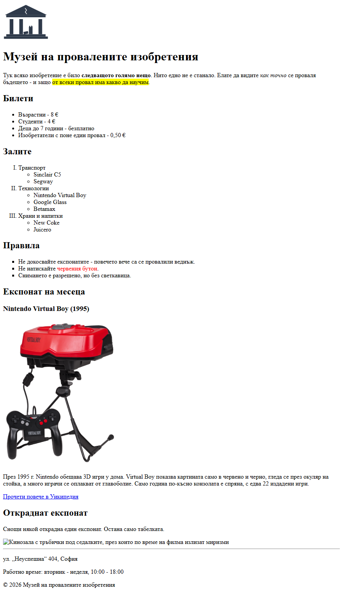

# 01.00.01 - Входът на музея

Музеят на провалените изобретения отваря врати, а още няма сайт. Днес правиш **началната страница**: табела с името, цени на билетите, залите, правилата и „Експонат на месеца“ - истинско изобретение, което се е провалило с гръм и трясък.

Няма цветове и оформление - това е работа за CSS в Модул 02. Сега важното е **съдържанието и структурата**.

## Какво правим

Накрая страницата ще изглежда горе-долу така (съдържанието е твое, структурата - същата):



## Какво ще научиш

- как изглежда скелетът на HTML документ и защо кирилицата и € понякога излизат като `���`
- заглавия, параграфи и текст с различна важност
- списъци - включително **списък в списък**
- линкове и изображения - и **относителни пътища**, най-важното нещо днес

## Отвори си

| Урок | За стъпки |
|------|-----------|
| [Структура на HTML документ](../Тема%2001%20-%20Основи%20на%20HTML/01-структура-на-html-документ.md) | 1, 2, 3 |
| [Линкове, изображения и списъци](../Тема%2001%20-%20Основи%20на%20HTML/02-линкове-изображения-списъци.md) | 2, 3, 4, 5 |
| [Експонати - готово съдържание](файлове/експонати.md) | 4 |
| [Текстове - готово съдържание](файлове/текстове.md) | 1, 2, 3, 5, 6 |
| [Първи стъпки](../Тема%2001%20-%20Основи%20на%20HTML/00-първи-стъпки.md) | ако файлът не се отваря или виждаш кода вместо страницата |

## Подготовка

Направи папка `museum/` (виж [как е подредена](README.md#папката-на-проекта)), в нея - празен файл `index.html` и празна папка `images/`.

> **Трик за VS Code:** в празен `.html` файл напиши `!` и натисни `Tab`. Получаваш целия скелет наготово.

---

## Стъпка 1 - Табелата на входа

Направи скелета на документа и сложи табелата на музея:

- езикът на страницата е български
- в таба на браузъра пише името на музея
- голямо заглавие с името на музея (можеш да измислиш свое)
- параграф, който представя музея. В него да има нещо **важно** (`<strong>`), нещо **с акцент** (`<em>`) и нещо **маркирано** (`<mark>`)

Текстовете за тази и следващите стъпки са готови в [текстове.md](файлове/текстове.md) - копираш текста, а таговете пишеш ти.

> **Подсказка:** Ако си ползвал `!` + `Tab`, намери `lang="en"` и го смени. Заглавието в таба е в `<title>`, а заглавието на страницата - в `<h1>`.

---

## Стъпка 2 - Билетите

Добави заглавие от второ ниво „Билети“ и под него поне три вида билети с цени. От 2026 г. в България плащаме в евро, така че цените са в **€**.

Провери, че `€` и кирилицата се виждат правилно.

**Експеримент (в час го показва преподавателят; пробвай го сам вкъщи).** „Счупи“ кодирането нарочно:

1. Във VS Code долу вдясно кликни на **UTF-8**.
2. Избери **Save with Encoding** (второто в менюто - **не** „Reopen with Encoding“) → **Cyrillic (Windows 1251)**.
3. Презареди страницата в браузъра.

Виждаш ли знаци като `�` вместо букви? Файлът казва „аз съм UTF-8“ (`<meta charset="UTF-8">`), а всъщност е записан по друг начин - и браузърът чете буквите грешно. Върни го веднага, преди да затвориш файла: **Windows 1251** долу вдясно → **Save with Encoding** → **UTF-8**.

> **Подсказка:** Цените са няколко неща от един и същи вид - значи са **списък**. Символът `€` на повечето клавиатури е `AltGr + E`; ако не стане - копирай го.

---

## Стъпка 3 - Залите и правилата

**Залите.** Добави номериран списък със залите на музея, номерирани с **римски цифри** (I, II, III…). Например: Транспорт, Технологии, Храни и напитки. В **поне една** зала сложи списък с експонатите в нея.

**Правилата.** Добави неномериран списък с правилата на музея, с маркери **плътни квадратчета**. В едно от правилата **само част** от текста да е червена: *„Не натискайте **червения бутон**.“*

> **Подсказка:** Видът на номерацията се сменя с атрибут на `<ol>`. Квадратчетата и червеният цвят са с атрибута `style`, а за парче текст има `<span>`.

> **Внимание:** Вложеният списък е **вътре** в `<li>`, преди затварящия `</li>`. Ако го сложиш *след* `</li>`, браузърът пак показва нещо, но структурата е грешна.
>
> ```html
> <ol>
>     <li>Плодове
>         <ul>
>             <li>Ябълка</li>
>             <li>Круша</li>
>         </ul>
>     </li>
>     <li>Зеленчуци</li>
> </ol>
> ```

---

## Стъпка 4 - Експонатът на месеца

Избери експонат от [експонати.md](файлове/експонати.md) - там има готов текст, снимка и линк, за да не губиш време в търсене. Направи му раздел:

- заглавие „Експонат на месеца“ (`<h2>`) и под него името на изобретението (`<h3>`)
- **снимката от интернет** (адресът е в реда „Снимка“), широка 300-400 пиксела - атрибут `width`
- текста за експоната
- линк „Прочети повече“ към статията в Уикипедия (редът „Уикипедия“), който се отваря **в нов таб**

> **Подсказка:** Адресът на снимката е стойността на `src`. За новия таб виж „Отваряне в нов таб“ в урока - обърни внимание и на `rel`.

> **Забележка:** `width` променя само колко голяма се **показва** снимката - браузърът пак изтегля целия файл. Затова в данните са дадени малки версии (500 пиксела), а не оригиналите.

---

## Стъпка 5 - Логото и откраднатият експонат

**Логото.** Изтегли [logo.svg](файлове/logo.svg) (бутон **Download raw file** горе вдясно) или си намери свое лого. Сложи го в папката `images/` и го покажи най-горе на страницата.

Това е изображение от **твоята папка**, а не от интернет. Пътят се пише **спрямо `index.html`** - откъдето е той, оттам „тръгваш“ към снимката.

**Откраднатият експонат.** Снощи някой открадна един експонат. Остана само табелката до него. Добави раздел „Откраднат експонат“ с изображение, чийто адрес **не съществува**, но с `alt` текст, който описва какво е трябвало да се вижда.

Да, тази снимка **няма да се покаже** - точно това е идеята. На нейно място браузърът показва малка иконка и текста от `alt`. Така виждаш на практика за какво служи `alt`.

> **Подсказка:** `index.html` и папката `images/` са на едно ниво. Значи пътят е: влез в `images`, вземи `logo.svg`. Разделителят е `/`, не `\`.

> **Внимание:** Път като `C:\Users\ivan\Desktop\museum\images\logo.svg` работи **само на твоя компютър**. Изпратиш ли сайта на някого - логото изчезва. Затова пътищата в сайта са винаги относителни.

> **Добра практика:** `alt` описва **какво има на снимката**, а не че е снимка. Не „снимка“, а например „Бял телефон с шайба и червен бутон за спешни повиквания“.

---

## Стъпка 6 - Долу на страницата

Отдели края на страницата с хоризонтална линия и добави **футър** с адреса на музея, работното време и `© 2026` с името на музея.

> **Подсказка:** `<hr>` и `<footer>`. Символът `©` можеш да копираш или да напишеш `&copy;`.

---

> **Ориентир:** Стъпки 1-6 са замислени за около 40 минути. Най-важни са 3 (вложеният списък) и 5 (пътища и `alt`) - не ги пропускай. Каквото не довършиш, довършваш вкъщи.

## Проверка

Преди да кажеш „готов съм“, мини през списъка. Ако нещо не се получава, свързаното упражнение е същото, но в по-малък вид.

| Провери | Упражнение |
|---------|------------|
| `index.html` се отваря в браузъра и в таба пише името на музея | 01.01.01 |
| Кирилицата и `€` се виждат правилно | 01.01.02 |
| Има **само едно** `<h1>`, а разделите са с `<h2>` | 01.01.01 |
| В текста има `<strong>`, `<em>` и `<mark>` | 01.01.03 |
| Част от едно правило е червена | 01.01.04, 01.01.05 |
| Има `<hr>` и `<footer>` | 01.01.06 |
| Линкът към Уикипедия се отваря в нов таб | 01.01.07 |
| Има 3 изображения: от интернет, от `images/` и „откраднатото“ - и **всяко** има `alt` | 01.01.08 |
| Залите са с римски цифри и поне една има вложен списък | 01.01.09 |
| Правилата са с квадратчета | 01.01.10 |
| [W3C Validator](https://validator.w3.org/#validate_by_input) не показва грешки - поставяш целия код и натискаш **Check**. Не разбираш съобщението? Виж [честите съобщения](README.md#чести-съобщения-от-валидатора). | - |

## Ако ти остане време

Без подсказки - търсиш сам. Не са задължителни.

1. **Такъв музей наистина съществува.** Потърси *Museum of Failure* - истински музей, открит в Швеция през 2017 г. Намери експонат, за който не си чувал, и го направи свой „Експонат на месеца“ - със свой текст и снимка от Уикипедия (кликни на снимката → **десен бутон → Copy image address**). Внимавай: на български статии има само за малко изобретения - търси в английската Уикипедия; оригиналните снимки са огромни, така че `width` е задължителен.
2. **Обратно броене.** Направи „Топ 5 на провалите“ като номериран списък, който брои отгоре надолу: 5, 4, 3, 2, 1. Има атрибут за това - намери го в [MDN](https://developer.mozilla.org/en-US/docs/Web/HTML/Reference/Elements/ol).
3. **Иконка в таба.** Малката иконка до заглавието в таба се казва **favicon**. Добавя се с един ред в `<head>` - `<link rel="icon" href="…">`, като `href` е пътят до картинката. Може да е `.png` (обикновено 32×32 пиксела), `.ico` или `.svg`. Направи своя - например опростено лого, или PNG от любимо emoji. Ако иконката не се появи веднага, браузърът пази старата в кеша - отвори страницата в нов таб или презареди с `Ctrl + F5`.
4. **Чуй страницата си.** Пусни екранния четец - на Windows **Narrator** (`Win + Ctrl + Enter`), на Mac **VoiceOver** (`Cmd + F5`). Какво казва за логото? А за откраднатия експонат? Така хора, които не виждат, „разглеждат“ сайтове.
5. **Надникни в чужд код.** Отвори сайта на истински музей и натисни `Ctrl + U`. Колко `<h1>` има? Има ли снимки без `alt`? После `F12` → **Elements** и посочи с мишката различни части от страницата.
6. **Музеят в интернет.** С [GitHub Pages](https://pages.github.com/) можеш да публикуваш сайта си безплатно и да пратиш линк на приятел. Работят ли снимките? Ако не - виж въпрос 2 отдолу.

## Въпроси за размисъл

С тях завършваме часа.

1. При откраднатия експонат браузърът показа текста от `alt`, защото снимката я няма. Но `alt` се чете и когато снимката си е на мястото. От кого и защо? (Ако не се сещаш - опитай идея 4 от „Ако ти остане време“.)
2. Защо `images/logo.svg` работи навсякъде, а `C:\Users\...\logo.svg` се чупи, щом пратиш сайта на някого?
3. `<strong>` и `<b>` изглеждат еднакво. Защо тогава има два различни тага?
4. Нарисувай на лист страницата си като **дърво**: `<html>` горе, под него `<head>` и `<body>`, под тях - каквото е вътре в тях. Къде на дървото е вложеният списък?

---

**Следва:** [01.00.02 - Сградата расте](02-сградата-расте.md): музеят получава още страници и навигация между тях.
