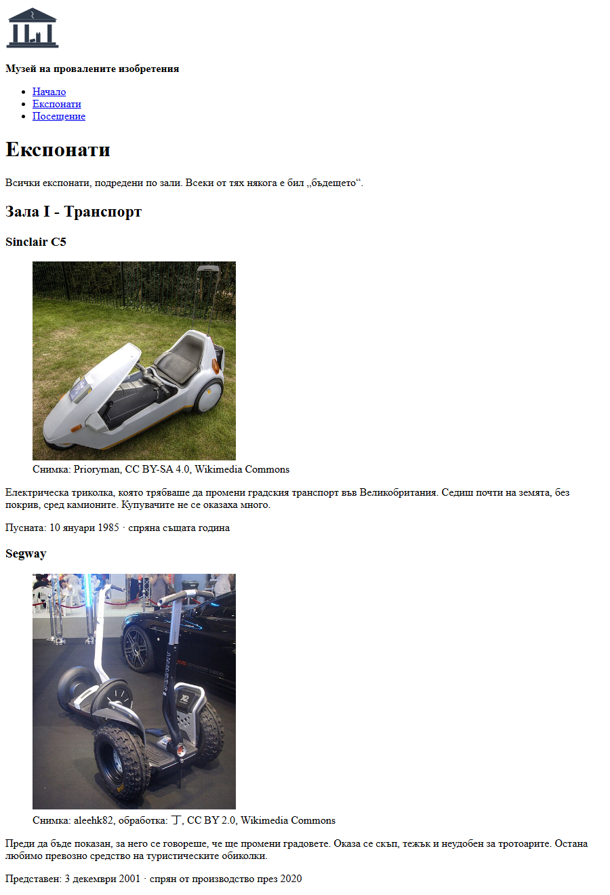

# 01.00.02 - Сградата расте

Музеят има вход, но една страница не е сграда. Днес добавяш още две - **каталог на експонатите** и страница **„Посещение“** - и ги свързваш с навигация.

По пътя ще преустроиш и входа: страницата ще изглежда почти същата, но отвътре ще бъде подредена със **семантични елементи**. Браузърът няма да покаже голяма разлика. Търсачките, екранните четци и всеки, който чете кода ти - ще покажат.

## Какво правим

Накрая каталогът на експонатите ще изглежда горе-долу така (показано е началото на страницата):

## Какво ще научиш

- семантичните елементи: `<header>`, `<nav>`, `<main>`, `<section>`, `<article>`, `<aside>`, `<footer>`
- сайт от няколко страници и навигация между тях
- линк към **конкретно място** в друга страница (`страница.html#място`)
- `<figure>` и `<figcaption>`, `<time>`, `
` и `
`, `<address>`

## Отвори си

| Урок | За стъпки |
|------|-----------|
| [HTML5 семантични елементи](../Тема%2002%20-%20HTML5%20семантични%20елементи/01-семантични-елементи.md) | всички |
| [Експонати - готово съдържание](файлове/експонати.md) | 3, 5 |
| [Пример: div срещу семантика](../Тема%2002%20-%20HTML5%20семантични%20елементи/примери/03-сравнение-div-vs-semantic.html) | 1 |
| [Пример: figure, details, time](../Тема%2002%20-%20HTML5%20семантични%20елементи/примери/02-figure-details-time.html) | 3, 5 |
| [Линкове, изображения и списъци](../Тема%2001%20-%20Основи%20на%20HTML/02-линкове-изображения-списъци.md) - „Вътрешни линкове“ | 2, 4 |

> **Съвет:** Примерите са `.html` файлове. В GitHub виждаш кода им; за да видиш как изглеждат, изтегли ги и ги отвори в браузъра.

## Подготовка

Продължаваш в папката `museum/` от [01.00.01](01-входът-на-музея.md). Не си я довършил или не си бил в час? Вземи примерното решение от папка `решения/` и продължи от него.

---

## Стъпка 1 - Преустрой входа

Подреди `index.html` в семантични блокове:

- **`<header>`** - логото и името на музея
- **`<nav>`** - списък с линкове „Начало“, „Експонати“, „Посещение“ (засега само „Начало“ работи - другите страници ги правиш в стъпка 2). Сложи го **вътре** в `<header>`. (Може и веднага след него - и двете са правилни; в урока е след него.)
- **`<main>`** - цялото основно съдържание
- **`<section>`** - всеки раздел (Билети, Залите, Правила…) е отделна секция, със своето `<h2>`
- **`<footer>`** - футърът вече го имаш; `
` можеш да махнеш

Запази и презареди. Ако страницата изглежда **почти същата** - направил си всичко правилно.

> **Подсказка:** Виж „Пълен пример - структура на страница“ в урока. Навигацията е неномериран списък от линкове: `<nav>` → `<ul>` → `<li>` → `<a>`.

> **Внимание:** Всяка `<section>` трябва да има заглавие. Ако нещо няма смислово заглавие, вероятно не е секция.

---

## Стъпка 2 - Още две стаи

Направи `exhibits.html` и `visit.html` в същата папка. Всяка нова страница има:

- **почти същия** `<header>` като началната - копирай го и направи две промени:
  - името на музея вече не е `<h1>`, а параграф (`
`)
  - логото става линк към началната страница
- **същия** `<footer>` - просто го копирай
- свое заглавие в таба, например „Експонати - Музей на провалените изобретения“
- `<main>` със **свое** `<h1>`: „Експонати“, съответно „Посещение“

Сега мини през **всички** линкове в навигацията от **всяка** страница. Трябва всичко да работи.

> **Добра практика:** На всяка страница има едно `<h1>` и то казва за какво е **тази** страница. На началната това е името на музея; на каталога - „Експонати“. Затова в хедъра на вътрешните страници името е само параграф.

---

## Стъпка 3 - Каталогът

Съдържанието е готово в [експонати.md](файлове/експонати.md) - текст, дата, снимка и автор за 7 експоната. Днес не губиш време в търсене, а в **структура**. В час направи **два**: **Sinclair C5** (Зала I) и **Nintendo Virtual Boy** (Зала II). Вторият е повторение на първия - останалите добави вкъщи, ако искаш.

В `exhibits.html` подреди експонатите **по зали**:

- всяка зала е `<section>` със заглавие (`<h2>`)
- всеки експонат е `<article>` със: заглавие (`<h3>`), снимка, текст и дата
- поне **2 експоната**, по един в зала

Снимката сложи в `<figure>` с надпис `<figcaption>` - **кой е авторът на снимката и какъв е лицензът** (в данните е редът „Надпис“).

Датата (кога е пуснато изобретението) сложи в `<time>` с атрибут `datetime`.

> **Подсказка:** `datetime` е датата във формат, който машините разбират: `1995`, `1995-07`, или `1995-07-21`. Между таговете пишеш каквото искаш за хората: `<time datetime="1995-07-21">21 юли 1995</time>`.

> **Важно:** Снимките в Commons са свободни, но повечето лицензи (CC BY, CC BY-SA) изискват да посочиш автора. Затова `figcaption` не е само за красота.

---

## Стъпка 4 - Директно до експоната

Дай на всеки `<article>` атрибут `id` - например `id="virtual-boy"`. После на началната страница превърни експонатите в списъка със залите в **линкове**, които водят направо до тях: `exhibits.html#virtual-boy`.

Кликни - браузърът трябва да отвори каталога и да скочи точно до този експонат.

> **Подсказка:** Виж „Вътрешни линкове“ в урока. Там `#` води до място на **същата** страница; тук просто слагаш името на другата страница отпред.

> **Внимание:** `id` е уникално в рамките на страницата, без интервали, а за удобство - с латиница и малки букви.

---

## Стъпка 5 - Посещение (вкъщи)

> **Вкъщи:** Тази стъпка е за вкъщи. За следващата практика е достатъчно `visit.html` да има хедъра, `<h1>` и футъра от стъпка 2 - формуляра ще сложиш в него.

В `visit.html` добави секции за:

- **адреса** - в `<address>`, с телефон и имейл като **линкове**: телефонът е с `tel:`, имейлът - с `mailto:`. (Урокът казва, че `<address>` е само за контактите на автора на сайта - тук авторът е самият музей, така че е точно на място.)
- **работното време**
- **често задавани въпроси** - поне 3, всеки в `
` с въпроса в `
`. Отговорът се показва при клик.
- **резервации** - засега само текст „Скоро“. Формуляра го правиш в следващата практика.

И на **каталога** добави `<aside>` със „Знаете ли, че…“ - любопитен факт за някой експонат (има няколко в края на [експонати.md](файлове/експонати.md)).

> **Подсказка:** Сложи `<aside>` **вътре** в `<main>`, защото фактът е свързан с експонатите на тази страница. (Когато е за целия сайт - например „За автора“ в примера от урока - отива до `<main>`.)

> **Подсказка:** Линковете към телефон и имейл изглеждат така: `<a href="tel:+359888123456">` и `<a href="mailto:info@example.com">`. На телефон първият директно започва обаждане.

---

> **Ориентир:** В час: стъпки 1-4, около 40 минути. Стъпка 5 е за вкъщи.

## Проверка

| Провери | Упражнение |
|---------|------------|
| Всички страници имат `<header>`, `<nav>`, `<main>` и `<footer>` | 01.02.01 |
| Навигацията е `<ul>` от линкове и работи от **всяка** страница | 01.02.01 |
| Всяка страница има точно едно `<h1>` и свое заглавие в таба | - |
| Всяка `<section>` има заглавие | - |
| В каталога експонатите са `<article>`, групирани в `<section>` по зали | 01.02.01 |
| Снимките са във `<figure>` с `<figcaption>`, който посочва автора | - |
| Има поне една дата в `<time datetime="…">` | - |
| Линк от началната страница води директно до експонат в каталога | - |
| *(вкъщи)* В „Посещение“ има `<address>`, работещи `tel:` и `mailto:` линкове и поне 3 `
`; в каталога има `<aside>` | - |
| [W3C Validator](https://validator.w3.org/#validate_by_input) не показва грешки за **всяка** страница | - |

## Ако ти остане време

1. **Свой експонат.** Намери провалено изобретение, което го няма в данните (идеи: Betamax, Zune, Smell-O-Vision, Bic Cristal For Her), и му направи `<article>`. Напиши текста със свои думи. Снимката търсиш в [Wikimedia Commons](https://commons.wikimedia.org/): отвори страницата на снимката → иконата със земното кълбо горе, с надпис **Use this file** / **on the web**. Там има **File URL** за `src` и **Attribution** - готовия текст за `<figcaption>` (сложи отметка на **HTML** до него, виж 01.00.04). File URL е оригиналът, често огромен - не забравяй `width`.
2. **Виж сайта като търсачка.** Отвори [валидатора](https://validator.w3.org/nu/#textarea), постави кода и сложи отметка на **outline** преди проверката. Получаваш „скелета“ на страницата - само заглавията и как са вложени. Има ли смисъл, ако го прочетеш без нищо друго? Пробвай и **image report** - показва `alt` на всяка снимка.
3. **„Ти си тук“.** Отбележи в навигацията на коя страница си в момента. Има атрибут точно за това, който четат и екранните четци - потърси `aria-current` в [MDN](https://developer.mozilla.org/en-US/docs/Web/Accessibility/ARIA/Reference/Attributes/aria-current).
4. **Описание за Google.** Под линка в резултатите на Google има кратко описание. Откъде идва? Прочети „Основни SEO фактори“ в [урока за SEO](../Тема%2002%20-%20HTML5%20семантични%20елементи/02-seo.md) и напиши различно описание за всяка страница.
5. **Музеят като данни.** Google може да покаже адреса и работното време на музея директно в резултатите. За целта страницата казва „аз съм музей, ето адреса ми“ на език, който машините разбират. Виж „Структурирани данни (Schema.org)“ в урока за SEO и потърси типа `Museum`.
6. **Прочети без снимки.** Пусни екранния четец (`Win + Ctrl + Enter`) на каталога. Различава ли се преживяването сега, когато има `<nav>`, `<main>` и `<article>`? Опитай да прескочиш директно до основното съдържание.

## Въпроси за размисъл

1. След стъпка 1 страницата изглежда почти същата. Тогава за кого е разликата?
2. Хедърът и навигацията са копирани в три файла. Какво става, когато музеят добави четвърта страница? А десета? (Решението идва в Модул 04.)
3. Защо всяка зала е `<section>`, а всеки експонат - `<article>`? Можеш ли да измислиш пример, в който би било обратното? (Помисли за дълга статия в блог.)
4. И `alt`, и `figcaption` „описват“ снимката. Каква е разликата между тях - кой кога ги вижда?

---

**Следва:** [01.00.03 - Касата](03-касата.md): онлайн резервация с формуляр.
