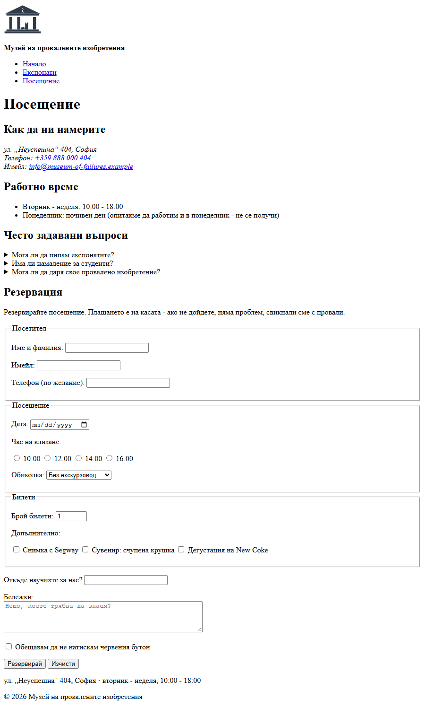

# 01.00.03 - Касата

Музеят има зали и посетители, но няма каса. Днес правиш **онлайн резервация** - формуляр, в който посетителят казва кой е, кога идва и колко билета иска.

Най-интересното: ще видиш **какво точно изпраща браузърът**, когато натиснеш бутона. Сървър още нямаме (той идва в Модул 04), затова ще пращаме данните към [httpbin.org](https://httpbin.org) - безплатна услуга, която просто ти връща обратно това, което е получила.

> **Внимание:** Данните отиват в интернет. Не пиши истински лични данни - измисли име, имейл и телефон.

## Какво правим

Накрая страницата „Посещение“ ще изглежда горе-долу така:

## Какво ще научиш

- как работи `<form>` и **какво всъщност изпраща** - и защо без `name` поле не стига до никъде
- различните видове `<input>`: текст, имейл, телефон, дата, число, радио бутони, отметки
- `<label>`, `<select>`, `<textarea>`, групиране с `<fieldset>`
- вградена проверка на данните: `required`, `min`, `max`, `minlength`
- разликата между **GET** и **POST** - с очите си

## Отвори си

| Урок | За стъпки |
|------|-----------|
| [HTML формуляри](../Тема%2003%20-%20Формуляри/01-формуляри.md) | всички |
| [Допълнителни HTML теми](../Тема%2004%20-%20Допълнителни/01-допълнителни.md) - раздел 8 „Допълнителни елементи на формуляри“ | 2, 3, 5 |
| [Текстове - готово съдържание](файлове/текстове.md) | 4, 5, 6 |

## Подготовка

Продължаваш в `museum/` от [01.00.02](02-сградата-расте.md). Работиш във `visit.html`: добави в `<main>` секция „Резервация“ със заглавие `<h2>`. (Ако си направил стъпка 5 от 01.00.02 вкъщи, секцията вече е там - махни само текста „Скоро“.)

---

## Стъпка 1 - Първото поле и първото изпращане

Направи формуляр с **едно** поле - име - и бутон „Резервирай“. Формулярът изпраща данните към:

- `action="https://httpbin.org/post"`
- `method="post"`

Полето има `<label>`, свързан с него. Въведи име и натисни бутона. Ще видиш отговор от httpbin - дълъг е, но те интересува само частта `"form"`. Там е твоето име.

> **Забележка:** Ако си писал на кирилица, името ще изглежда като `\u0418\u0432\u0430\u043d`. Това **е** твоето име, а не повредени данни - така JSON записва всяка буква като код (`\u0418` е „И“, `\u0432` е „в“…). Помниш ли кодирането от 01.00.01? Ако ти е по-лесно за четене, пиши на латиница.

Сега направи **експеримент**: махни атрибута `name` от полето, върни се и изпрати отново. Какво има в `"form"` този път? Върни `name` обратно.

> **Подсказка:** Виж „Елементът `<form>`“ и „Етикети“ в урока. `for` на етикета сочи `id` на полето. Провери, че е свързан правилно: клик върху текста на етикета трябва да постави курсора в полето.

> **Важно:** `id` е за браузъра и етикета; `name` е **името, под което данните пристигат на сървъра**. Без `name` полето просто не се изпраща.

---

## Стъпка 2 - Кой идва

Сложи полето за име в `<fieldset>` с надпис (`<legend>`) „Посетител“ и добави:

- **имейл** - задължителен, с правилния тип поле, за да проверява браузърът дали прилича на имейл
- **телефон** - по желание

Направи и името задължително, с поне 2 символа. Пробвай да изпратиш празен формуляр, после с имейл без `@`. Какво казва браузърът?

> **Подсказка:** Типът на полето за имейл е `email`, за телефон - `tel`. Задължителните полета са с `required`, а минималната дължина - с `minlength`.

---

## Стъпка 3 - Кога

Нов `<fieldset>` „Посещение“ с:

- **дата** - задължителна, с календар
- **час на влизане** - радио бутони: 10:00, 12:00, 14:00, 16:00. Може да се избере само един.
- **обиколка** - падащ списък: без екскурзовод, с аудиогид, с екскурзовод на български, с екскурзовод на английски

Изпрати и виж в httpbin как пристигат датата и часът.

> **Подсказка:** Радио бутоните са една група, защото имат **еднакво `name`** - виж „Радио бутони и чекбоксове“ в урока. Всеки има различна `value` - това е, което се изпраща.

> **Подсказка:** Ако искаш опциите в списъка да са групирани („Сами“ / „С екскурзовод“), виж `<optgroup>` в раздел 8 на допълнителните теми.

---

## Стъпка 4 - Колко са

Трети `<fieldset>` „Билети“ с поле **брой билети** - число от 1 до 10, като започва от 1.

Под тях - **отметки** за допълнителни услуги. Готови са в [текстове.md](файлове/текстове.md) - или си измисли свои.

Избери две отметки и изпрати. Как изглеждат в httpbin?

> **Подсказка:** Числовото поле е `type="number"` с `min`, `max` и начална стойност `value`. Отметките са `type="checkbox"` - и при тях всички в групата имат еднакво `name`.

---

## Стъпка 5 - GET срещу POST

На **началната** страница добави секция „Бюлетин“ с малък формуляр: само имейл и бутон „Абонирай ме“. Този път:

- `action="https://httpbin.org/get"`
- `method="get"`

Изпрати и **погледни адресната лента**. После сравни с резервацията. Къде са данните в единия и в другия случай?

> **Забележка:** При GET httpbin показва данните в частта `"args"`, а не във `"form"`. В адресната лента `@` се вижда като `%40` - пак код за знак, както `\u` в стъпка 1.

> **Подсказка:** Виж таблицата „GET срещу POST“ в урока.

---

## Стъпка 6 - Последни детайли (вкъщи)

> **Вкъщи:** Тази стъпка е за вкъщи - новите елементи в нея (`<datalist>`, `<textarea>`) не носят нова идея за това как работи формулярът.

Във формуляра за резервация, след трите групи, добави:

- **„Откъде научихте за нас?“** - поле, което предлага готови отговори, но позволява и свой (`<datalist>`, раздел 8 на допълнителните теми)
- **бележки** - `<textarea>` с `placeholder`
- **задължителна отметка** „Обещавам да не натискам червения бутон“
- бутон **„Изчисти“** до „Резервирай“

---

> **Ориентир:** В час: стъпки 1-5, около 40 минути. Стъпка 6 е за вкъщи. Стъпка 1 е най-важната - не я прескачай, дори да изглежда лесна.

## Проверка

| Провери | Упражнение |
|---------|------------|
| Формулярът изпраща към httpbin и в `"form"` се виждат **всички** попълнени полета | - |
| Всяко поле има `<label>`, и клик върху етикета води до полето | 01.03.01 |
| Полетата са групирани в `<fieldset>` с `<legend>` | 01.04.08 |
| Име и имейл са задължителни; имейлът е `type="email"` | 01.03.02 |
| Датата е с календар, часът - радио бутони, от които се избира само един | 01.03.01 |
| Има падащ списък | 01.03.01 |
| *(вкъщи)* Има `<textarea>` и задължителна отметка | 01.03.03 |
| Броят билети не може да е под 1 или над 10 | - |
| *(вкъщи)* Има `<datalist>` | 01.04.09 |
| Бюлетинът е с GET и данните се виждат в адресната лента | - |
| [W3C Validator](https://validator.w3.org/#validate_by_input) не показва грешки | - |

## Ако ти остане време

1. **Хакни собствения си формуляр.** Отвори `F12` → **Elements**, намери полето за брой билети и смени `max="10"` на `max="1000"`. Или изтрий `required` от имейла. Сега изпрати. Какво значи това за всеки сайт в интернет? (Виж и въпрос 3 отдолу.)
2. **Само български номера.** Направи така, че телефонът да се приема само във формат `+359` и 9 цифри. Атрибутът е `pattern`, а стойността му е **регулярен израз** - малък език за описание на текст. Пробвай го на [regex101.com](https://regex101.com). Използвай и `title`, за да обясниш формата на потребителя.
3. **Браузърът попълва вместо теб.** Атрибутът `autocomplete` подсказва на браузъра какво е полето (`name`, `email`, `tel`…), за да предложи запазените ти данни. Добави го на полетата за посетителя.
4. **Без дати от миналото.** Направи така, че да не може да се резервира дата преди откриването на музея. Кой атрибут работи и при датите, не само при числата?
5. **Формулярът на телефон.** Ако си публикувал музея с GitHub Pages (01.00.01), отвори формуляра от телефона. Каква клавиатура се появява за имейла? За телефона? За броя билети?

## Въпроси за размисъл

1. Какво стана, когато махна `name` в стъпка 1? Защо `id` не е достатъчен?
2. Къде отидоха данните при GET и къде при POST? С кой от двата не би изпратил парола - и защо?
3. Ако махнеш `required` през DevTools, формулярът се изпраща. Значи ли това, че проверките в HTML са безполезни? Кой **задължително** трябва да проверява данните? (Отговорът е в Модул 04.)
4. Защо радио бутоните за час имат **еднакво** `name`, а полетата за име и имейл - **различно**?

---

**Следва:** [01.00.04 - Мултимедийната зала](04-мултимедийната-зала.md): таблици, видео, карта и залата на провалените HTML тагове.
