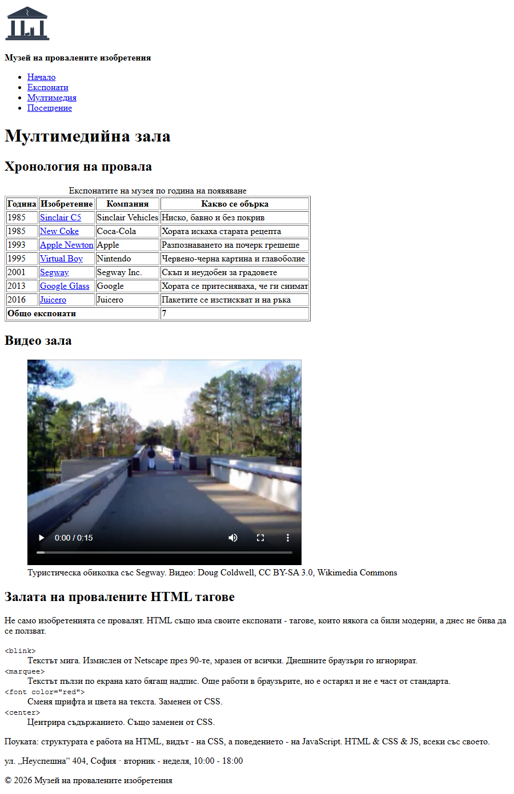

# 01.00.04 - Мултимедийната зала

Всеки модерен музей има зала с екрани. Днес правиш **мултимедийната зала** на нашия: хронология на провалите в таблица, видео зала и една специална експозиция - **Залата на провалените HTML тагове**. Защото и HTML има своите провали.

Накрая музеят получава и **карта** до входа, и **промоция** на билетите.

С тази практика сградата е готова. В Модул 02 започва интериорът - CSS.

## Какво правим

Накрая новата страница ще изглежда горе-долу така:

## Какво ще научиш

- таблици: `<caption>`, `<thead>`, `<tbody>`, `<tfoot>`, `colspan`
- видео с `<video>` и вграждане на чужда страница с `<iframe>`
- как да покажеш `<` и `>` като текст - **HTML entities**
- списък с дефиниции: `<dl>`, `<dt>`, `<dd>`
- `<del>` и `<ins>` - какво е изтрито и какво е добавено

## Отвори си

| Урок | За стъпки |
|------|-----------|
| [Допълнителни HTML теми](../Тема%2004%20-%20Допълнителни/01-допълнителни.md) - раздели 1, 2, 3, 5, 6, 9 | всички |
| [Линкове, изображения и списъци](../Тема%2001%20-%20Основи%20на%20HTML/02-линкове-изображения-списъци.md) - „Таблици“ | 2 |
| [Експонати - готово съдържание](файлове/експонати.md) - „Видео за 01.00.04“ | 3 |
| [Текстове - готово съдържание](файлове/текстове.md) | 2, 4, 6 |

## Подготовка

Продължаваш в `museum/` от [01.00.03](03-касата.md).

---

## Стъпка 1 - Нова зала

Направи `media.html` със същия хедър и футър като останалите страници и `<h1>` „Мултимедийна зала“. Добави я в навигацията - на **всички** страници.

Да, пак копираш навигацията във всеки файл. Запомни колко ти е досадно - ще ти трябва за въпрос 4 отдолу.

---

## Стъпка 2 - Хронология на провала

Направи таблица с **3 експоната**, подредени по година (още редове не учат нищо ново - само набиране). Данните са готови в [текстове.md](файлове/текстове.md):

| Година | Изобретение | Компания | Какво се обърка |
|--------|-------------|----------|-----------------|
| 1985 | Sinclair C5 | Sinclair Vehicles | Ниско, бавно и без покрив |
| … | … | … | … |

Изисквания:

- заглавен ред в `<thead>`, експонатите в `<tbody>`, а в `<tfoot>` - ред „Общо експонати“ с техния брой, като текстът заема **три клетки** наведнъж
- надпис над таблицата с `<caption>`
- името на всяко изобретение е линк към него в каталога (помниш `exhibits.html#…` от 01.00.02)

> **Подсказка:** Виж „Таблици“ в урока за линкове и раздел 9 за `<tfoot>`. Клетка, която заема няколко колони, е с `colspan`. `<caption>` го няма в уроците - виж го в [MDN](https://developer.mozilla.org/en-US/docs/Web/HTML/Reference/Elements/caption).

> **Забележка:** Без рамки таблицата е трудна за четене, затова урокът ползва `border="1"`. Валидаторът ще покаже **Warning**, че атрибутът е остарял (и странно споменава `img` - не му обръщай внимание). Това не е грешка. В Модул 02 рамките ще ги правим с CSS.

---

## Стъпка 3 - Видео зала

Добави видео със Segway - с контроли за пускане и спиране, картинка преди пускане и надпис кой е авторът. Адресът на видеото, картинката и надписът са готови в [експонати.md](файлове/експонати.md), в раздела „Видео за 01.00.04“.

Сложи видеото във `<figure>` с `<figcaption>`, точно както снимките в каталога.

> **Подсказка:** Виж раздел 6 в урока. Без атрибута `controls` видеото се показва, но няма как да го пуснеш. С атрибута `poster` можеш да покажеш картинка, докато видеото не е пуснато.

---

## Стъпка 4 - Залата на провалените HTML тагове

Не само изобретенията се провалят. Добави секция за HTML таговете, които някога са били модерни, а днес не бива да се ползват: `<blink>`, `<marquee>`, ``, `
`.

- направи ги **списък с дефиниции**: тагът е терминът, а обяснението - какво е правил и защо вече не се ползва
- таговете трябва да се виждат **буквално** на страницата, със знаците `<` и `>`
- добави изречение със знака `&`, например „HTML &amp; CSS &amp; JS“

Обясненията са готови в [текстове.md](файлове/текстове.md). Любопитно ти е какво още е остаряло? В [MDN](https://developer.mozilla.org/en-US/docs/Web/HTML/Reference/Elements#obsolete_and_deprecated_elements) има цял списък.

> **Подсказка:** Разделите в урока са 1 (entities) и 2 (`<dl>`). Ако напишеш `<blink>` направо, браузърът ще го приеме за таг, а не за текст - пробвай да видиш какво става.

> **Подсказка:** За да изглежда като код, сложи тага в `<code>`: `<dt><code>&lt;blink&gt;</code></dt>`.

---

## Стъпка 5 - Карта

В `visit.html` добави секция „Карта“ с вградена карта.

Музеят е измислен, затова избери място по свой вкус - например до ФМИ. Отвори [openstreetmap.org](https://www.openstreetmap.org), намери мястото и кликни **Share** (иконата вдясно на картата). Сложи отметка на **Include marker** - иначе на картата няма карфица - после избери **HTML** и копирай кода. Това е `<iframe>`.

Кодът от OSM вече съдържа линк **View Larger Map** под картата. Преведи текста му на „Виж по-голяма карта“ и направи така, че да се отваря в нов таб.

> **Важно:** Всеки `<iframe>` трябва да има `title`, който казва какво има в него. Кодът от OSM **няма** такъв - добави го сам: `<iframe title="Карта: местоположение на музея" …>`. Екранният четец не може да „види“ картата и чете `title`.

---

## Стъпка 6 - Промоция

На началната страница намали студентския билет за ноември: старата цена да се вижда **зачеркната**, а новата - като **добавена**.

> **Подсказка:** Раздел 3 в урока - `<del>` и `<ins>`. Те не просто зачеркват и подчертават - казват, че нещо е **премахнато** и **добавено**.

---

> **Ориентир:** Стъпки 1-6 са замислени за около 40 минути. Стъпка 4 е най-интересната - не я пропускай. Ако не стигнеш до картата (стъпка 5), направи я вкъщи.

## Проверка

| Провери | Упражнение |
|---------|------------|
| `media.html` е в навигацията на **всички** страници | - |
| Таблицата има `<caption>`, `<thead>`, `<tbody>` и `<tfoot>` с `colspan` | 01.04.10 |
| Имената в таблицата са линкове към каталога | - |
| Видеото се пуска, има контроли и надпис с автора | 01.04.06 |
| Провалените тагове се виждат буквално със `<` и `>`, в `<dl>` | 01.04.01, 01.04.02 |
| Картата е `<iframe>` с `title` | 01.04.05 |
| Студентският билет е с `<del>` и `<ins>` | 01.04.03 |
| [W3C Validator](https://validator.w3.org/#validate_by_input) не показва грешки (warning за `border` е наред) | - |

## Ако ти остане време

1. **Свое видео.** Намери друго видео в [Wikimedia Commons](https://commons.wikimedia.org/) - напиши името на изобретението и избери **Video**. Избери файл **`.webm`** - файловете `.ogv` в Chrome често пускат само звук, без картина. На страницата на видеото натисни иконата със земното кълбо горе, с надпис **Use this file** / **on the web**: **File URL** е адресът за `src`, а **Attribution** - надписът за `<figcaption>`. **Сложи отметка на HTML** до Attribution - иначе текстът съдържа `<https://…>`, който браузърът приема за таг. Предпочиташ YouTube? Под видеото → **Share** → **Embed** дава готов `<iframe>` (раздел 5 в урока).
2. **Нарисувай експонат.** Отвори `images/logo.svg` в редактора - логото не е снимка, а **код**: правоъгълници и триъгълници с координати. Прочети раздел 7 в урока и нарисувай свой експонат директно в HTML с `<svg>` - например счупена крушка от кръг, правоъгълник и начупена линия.
3. **Аудиогид.** Запиши с телефона си 20 секунди, в които разказваш за любимия си експонат. Сложи файла в папката и го добави с `<audio>`.
4. **Субтитри.** Добави субтитри на видеото с `<track>` и файл `.vtt` - потърси *WebVTT* в MDN. **Внимание:** когато отваряш страницата с двоен клик, Chrome не зарежда субтитрите от съображения за сигурност. Инсталирай разширението **Live Server** във VS Code и отвори страницата през него.
5. **Защо не всичко може в `<iframe>`?** Опитай да вградиш `https://www.google.com` или сайта на своята банка. Какво се случва? Потърси *clickjacking* - защо сайтовете забраняват да бъдат вграждани.
6. **Зареждай само каквото се гледа.** Атрибутът `loading="lazy"` казва на браузъра да зареди снимката или картата едва когато потребителят стигне до нея. Добави го и сравни в `F12` → **Network** колко неща се зареждат при отваряне на каталога.

## Въпроси за размисъл

1. Защо за `<` трябва да пишеш `&lt;`? Какво стана, когато написа `<blink>` направо?
2. Хронологията е таблица, а залите на началната страница - списък. Как решаваш кое кое да е? Кога таблицата е **грешен** избор? (Подсказка: как са подреждали цели страници през 90-те?)
3. Видеото и повечето снимки са с лиценз CC BY или CC BY-SA. Какво означават `BY` и `SA` и какво те задължават, ако ги ползваш на свой сайт? (Потърси на [creativecommons.org](https://creativecommons.org/licenses/).)
4. Вече копира навигацията в четири файла. Колко файла трябва да промениш, ако преименуваш „Посещение“ на „Билети“? Как би искал да работи това?

---

**Следва:** Модул 02 - CSS. Сградата е готова; време е за интериора.
